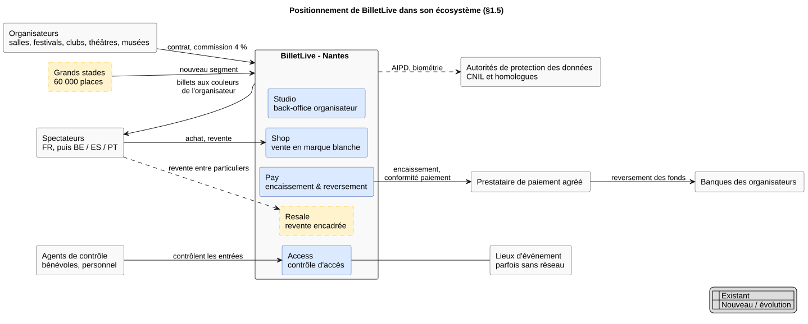

# 1. Contexte de l'entreprise

## 1.1 L'entreprise et son métier

BilletLive édite une plateforme de billetterie en marque blanche : la vendre des billets pour le compte d'organisateurs d'événements et se rémunère par une commission moyenne de 4 % sur le prix du billet.

| Indicateur                               | Valeur                        | Ce qu'on en déduit                                                  |
| :--------------------------------------- | :---------------------------- | :------------------------------------------------------------------ |
| Organisateurs clients                    | 1 400 (salles, théâtres, etc) | Plateforme multi-locataire, besoins hétérogènes                     |
| Billets vendus                           | 6,2 M                         | ≈ 17 000 billets/jour en moyenne, très concentrés sur quelques pics |
| Chiffre d'affaires                       | 14 M€                         | ≈ 2,26 € de revenu par billet (prix moyen ≈ 56 €)                   |
| Plafond d'infrastructure (0,04 €/billet) | ≈ 250 k€/an                   | L'infrastructure doit coûter < 2 % du revenu par billet             |

**Organisation (38 personnes, un seul site).**

| Équipe                | Effectif | Remarque pour l'architecture                                      |
| :-------------------- | :------- | :---------------------------------------------------------------- |
| Développement         | 12       | Pratiques modernes : CI/CD, infrastructure as code, observabilité |
| Ingénierie plateforme | 1        | Point de fragilité : une seule personne pour le socle technique   |
| Commerciaux           | 9        | Recrutement et suivi des organisateurs                            |
| Support client        | 8        | Assistance aux organisateurs et aux spectateurs                   |
| Fonctions support     | 8        | Finance, RH, administration                                       |

**Équipe informatique.**

Aucune DSI distincte de l'équipe produit, aucune équipe d'exploitation et aucune astreinte système:

- L'équipe n'a aucune compétence en administration de matériel et n'a jamais possédé de serveur : elle conçoit, déploie et exploite elle-même ce qu'elle développe.

**SI existant et ses limites.**

Le SI se confond avec la plateforme vendue aux organisateurs : quatre produits exploités en mode SaaS. Les fonctions support (comptabilité, RH, CRM commercial) n'ont rien de spécifique au métier. On les suppose couvertes par des logiciels SaaS du marché. Limites constatées :

- le reversement aux organisateurs ne fournit qu'un récapitulatif mensuel, non rapprochable transaction par transaction ;
- les organisateurs n'ont aucune visibilité en temps réel sur leurs ventes et leurs entrées ;
- la revente entre particuliers n'est pas prise en charge ;
- le contrôle d'accès est conçu pour des salles et des festivals, pas pour des stades de 60 000 places ;
- le périmètre est uniquement français.

## 1.2 Produits et services

BilletLive vend un service B2B à des organisateurs, qui l'utilisent pour vendre en B2C à leurs spectateurs (modèle B2B2C). Le spectateur achète sur une boutique aux couleurs de l'organisateur et ne voit pas BilletLive.

| Produit               | Pour qui                                  | Ce qu'il apporte                                                                                 |
| :-------------------- | :---------------------------------------- | :----------------------------------------------------------------------------------------------- |
| **BilletLive Shop**   | Spectateurs                               | Boutique en ligne en marque blanche, déclinée aux couleurs de chaque organisateur                |
| **BilletLive Studio** | Organisateurs                             | Back-office : plan de salle, catégories tarifaires, quotas, filières de distribution             |
| **BilletLive Access** | Agents de contrôle (bénévoles, personnel) | Contrôle d'accès sur smartphone ou sur douchette professionnelle                                 |
| **BilletLive Pay**    | Organisateurs                             | Encaissement des ventes via un prestataire de paiement agréé, puis reversement aux organisateurs |

**Canal de distribution.**

Les commerciaux recrutent et suivent les organisateurs. Les spectateurs arrivent par la communication de l'organisateur.

**Saisonnalité et pics.**

La charge est extrême et irrégulière :

- **charge nominale** : environ 200 requêtes par seconde ;
- **pic de mise en vente** : 40 000 requêtes par seconde, quand 180 000 personnes arrivent en 3 minutes, soit _un facteur 200_ ;
- **fréquence des pics** : une douzaine de mises en vente critiques par an, dont les dates sont connues plusieurs semaines à l'avance pour une meilleure planification.

**Engagements implicites pour les organisateurs.**

Ces engagements fondent la confiance des clients :

- ne jamais survendre une place ;
- traiter les acheteurs équitablement dans la file d'attente ;
- assurer le contrôle des entrées le jour J, même sans réseau ;
- encaisser et reverser des fonds qui appartiennent à l'organisateur.

## 1.3 Évolution et innovation souhaitées selon le document

| Évolution                                                                 | Ce qu'elle change dans le métier                                                                                                                                                                         | Ordre de grandeur                                                                                            |
| :------------------------------------------------------------------------ | :------------------------------------------------------------------------------------------------------------------------------------------------------------------------------------------------------- | :----------------------------------------------------------------------------------------------------------- |
| **Expansion vers la Belgique, l'Espagne et le Portugal**                  | Boutiques multilingues (FR/NL, ES, PT), moyens de paiement locaux (par exemple Bancontact, Bizum, MB WAY), règles locales de revente et de fiscalité                                                     | Volume de billets **× 3 en deux ans** (≈ 18,6 M billets/an)                                                  |
| **Grands stades**                                                         | Nouveau segment : des entrées massives et concentrées sur un tourniquet automatisé, et non plus un bénévole avec un smartphone                                                                           | 60 000 entrées en moins d'une heure sur 40 tourniquets, soit **≈ 1 passage toutes les 2,4 s par tourniquet** |
| **BilletLive Resale** (nouveau produit)                                   | Revente encadrée entre particuliers : le billet revendu est invalidé et un nouveau titre est émis pour l'acheteur. L'organisateur fixe le prix plafond et le nombre de reventes                          | Exigence : un billet ne peut jamais exister deux fois                                                        |
| **Pilotage en temps réel et reversement détaillé**                        | Studio passe de la configuration au tableau de bord en direct. Pay passe du récapitulatif mensuel à l'état de reversement **détaillé à la transaction**                                                  | Ventes et entrées visibles pendant l'événement                                                               |
| **Entrée sans billet par reconnaissance faciale** (innovation principale) | Le spectateur volontaire s'enregistre avec une photo, puis franchit le tourniquet sans billet ni téléphone. Le contrôle passe de la **vérification d'un document** à l'**identification d'une personne** | Service **facultatif**, avec consentement explicite. Le scan reste disponible pour tous                      |

La reconnaissance faciale soulève des questions que l'entreprise n'a pas encore tranchées : quelles données conserver, où, combien de temps, et comment retirer son consentement selo la RGPD.

## 1.4 Contraintes structurantes

**Réglementaires**

- **RGPD.** La plateforme traite les données personnelles de millions de spectateurs en tant que **sous-traitant** des organisateurs (hypothèse à confirmer contrat par contrat).
- **Biométrie (article 9 du RGPD).** Les données biométriques sont une catégorie particulière :
  - le **consentement doit être explicite** et **retirable** à tout moment ;
  - une **alternative sans désavantage** doit exister : c'est le scan ;
  - une **analyse d'impact (AIPD)** est obligatoire avant la mise en service ;
  - les données doivent être minimisées et leur durée de conservation strictement limitée.
- **Paiement**
  - **DSP2** : l'authentification forte (3-D Secure) s'applique au moment de l'achat, y compris pendant les pics.
  - **PCI-DSS** : le recours à un prestataire de paiement agréé réduit le périmètre, à condition qu'aucune donnée de carte ne transite par BilletLive.
  - **Fonds de tiers** : les fonds encaissés appartiennent aux organisateurs. Leur détention et leur reversement doivent reposer sur le prestataire agréé, ce qui évite à BilletLive de devoir obtenir un agrément d'établissement de paiement (hypothèse à valider).
- **Comptables.** Chaque transaction et chaque reversement doivent être traçables et les pièces conservées (10 ans en France).
- **Revente.** En France, la revente sans autorisation de l'organisateur est interdite (loi n° 2012-348). Resale doit donc rester **sous le contrôle de l'organisateur**. Les règles belges, espagnoles et portugaises sont à vérifier pays par pays.

**Budgétaires**

- Coût d'infrastructure **< 0,04 € par billet**, soit environ 250 k€/an aujourd'hui et environ 750 k€/an après le triplement.
- Ce coût doit être **mesurable par organisateur et par événement**.
- La capacité de pointe ne doit pas être payée toute l'année.

**Humaines et organisationnelles**

- 12 développeurs et 1 ingénieur plateforme, **sans astreinte 24 h/24** ni compétence en matériel.
- Il faut donc réduire au strict nécessaire le nombre de composants que BilletLive maintient elle-même en condition opérationnelle.

**Terrain**

- **Connectivité.** Les festivals et certains sites n'ont pas de réseau fiable : le contrôle doit fonctionner hors ligne.
- **Équipements hétérogènes.** Le contrôle se fait sur les smartphones personnels des bénévoles comme sur des douchettes professionnelles. S'y ajouteront les tourniquets des stades, qui sont des équipements tiers.

**Dépendances à l'existant**

- Il faut faire évoluer la plateforme sans interrompre le service des 1 400 organisateurs déjà clients.
- Les billets déjà émis doivent rester valides.

## 1.5 Schéma de positionnement

