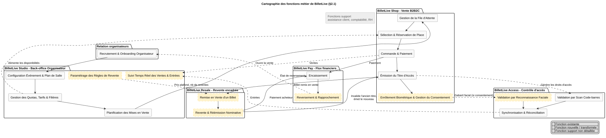
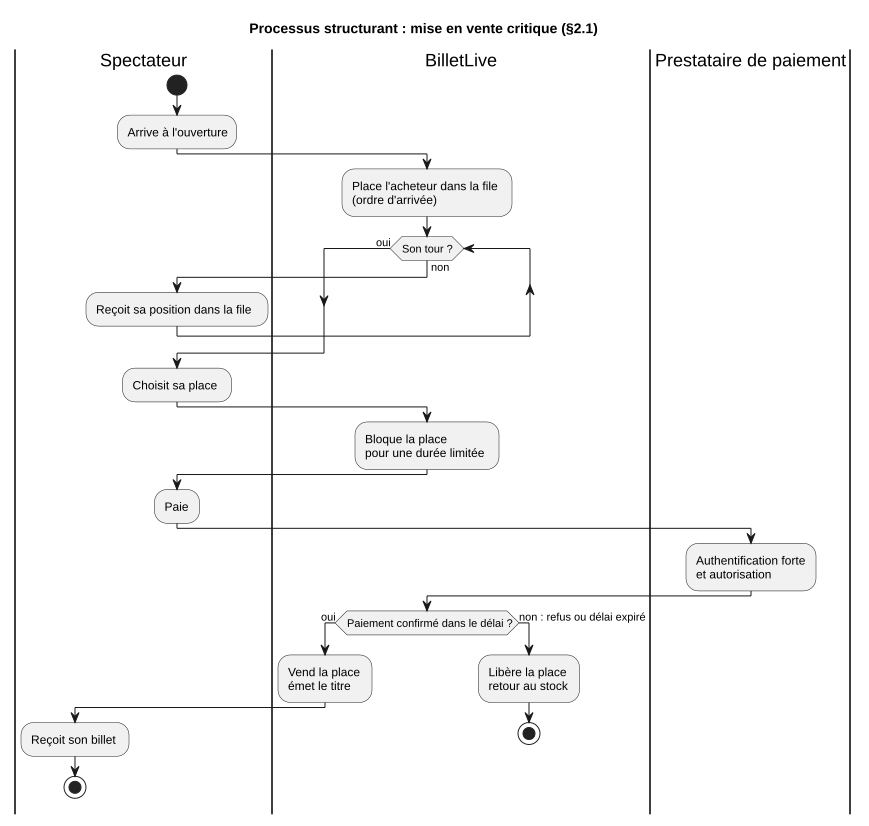

# 2. Vue métier

## 2.1 Fonctions métier principales

La cartographie ci-dessous représente l'enchaînement des fonctions métier de BilletLive, regroupées par offre : Studio, Shop, Resale, Pay et Access. Les fonctions en jaune sont nouvelles ou transformées par l'évolution.

Description des fonctions métier :

**Relation organisateurs**

- Recrutement & Onboarding Organisateur : Contractualisation avec l'organisateur de l'événement, vérification de son identité et de son compte bancaire, ouverture de sa boutique en marque blanche. Elle manipule le contrat, les taux, les coordonnées bancaires et la charte graphique.

**BilletLive Studio**

- Configuration Événement et Plan de Salle : Permet à l'organisateur de définir la structure de son événement, de dessiner son plan de salle, et de préparer la mise en vente.
- Gestion des Quotas, Tarifs & Filières : Consiste à allouer des volumes de places par catégories de prix, à les répartir entre filières de distribution (grand public, abonnés, partenaires…) et gérer la quantité générale de personnes.
- Planification des Mises en Vente : Fixe la date et l'heure d'ouverture des ventes et signale les mises en vente critiques. Ces dates, connues plusieurs semaines à l'avance, permettent d'anticiper la montée en charge.
- Paramétrage des Règles de Revente _(nouvelle)_ : L'organisateur autorise ou non la revente, fixe le prix plafond, le nombre de reventes autorisées par billet et la date limite de revente.
- Suivi Temps Réel des Ventes & Entrées _(changée)_ : Tableau de bord des ventes, des reventes et des entrées pendant la mise en vente et pendant l'événement.

**BilletLive Shop**

- Gestion de la File d'Attente : Capacité cruciale à orchestrer l'arrivée massive d'acheteurs de manière équitable, en leur restituant leur position, sans faire s'effondrer le système de réservation.
- Sélection et Réservation de Place : Permet à un acheteur de choisir sa place et garantit son verrouillage temporaire strict (unicité) le temps de finaliser la commande. Si le délai de réservation expire ou si le paiement échoue, la place est libérée.
- Commande et Paiement : Constitue la commande (places, tarifs, frais) et déclenche le paiement auprès de l'encaissement. La vente n'est définitive qu'après confirmation du paiement.
- Émission du Titre d'Accès : Génère le billet dématérialisé nominatif, signé et véritable. Pour la revente, elle émet le nouveau titre de l'acheteur et invalide celui du vendeur.
- Enrôlement Biométrique et Gestion du Consentement _(nouvelle)_ : Le spectateur volontaire fournit une photographie et donne un consentement explicite, rattaché à un billet et à un événement. Il peut retirer ce consentement à tout moment, ce qui entraîne l'effacement de ses données biométriques ; il passe alors par le scan.

**BilletLive Resale** _(nouveauté)_

- Remise en Vente d'un Billet : Le détenteur met son billet en vente dans le respect des règles de l'organisateur. Dès sa mise en vente, le titre n'est plus valide pour entrer. S'il n'est pas vendu à la date limite, un nouveau titre est réémis au vendeur (hypothèse retenue).
- Revente et Réémission Nominative : À l'achat, la vente est enregistrée, l'acheteur paie, un nouveau titre nominatif est émis et le compteur de reventes est incrémenté.

**BilletLive Pay**

- Encaissement : Collecte le paiement de l'acheteur via le prestataire de paiement agréé (authentification forte DSP2). Il manipule l'autorisation, l'identifiant de transaction du prestataire, le montant et la commission.
- Reversement et Rapprochement _(changée)_ : Calcule ce qui revient à chaque organisateur : ventes moins commission, remboursements et reventes. Il commence le reversement, puis rapproche chaque ligne avec les mouvements constatés chez le prestataire. Le récapitulatif mensuel devient un état détaillé à la transaction.

**BilletLive Access**

- Validation par Scan Code-barres : Contrôle des billets aux entrées de manière ultra-rapide, avec la capacité de fonctionner sans réseau internet continu.
- Validation par Reconnaissance Faciale _(nouvelle)_ : Au tourniquet d'un stade, compare le visage du spectateur aux gabarits des seuls spectateurs enrôlés pour cet événement. En cas d'échec, le spectateur est redirigé vers le scan.
- Synchronisation et Réconciliation : Charge sur les terminaux la liste des titres valides et invalidés (reventes, annulations) avant et pendant l'événement. Elle collecte ensuite les scans pour empêcher la double entrée, même si plusieurs portes de contrôle sont déconnectées temporairement, puis consolide le tout.

### Processus structurant : mise en vente critique

C'est le processus où se rencontrent l'exigence de pic de charge (ENF-1) et l'exigence d'unicité (EF-1). Il est représenté avec son cas d'échec.

## 2.2 Acteurs du SI

Les acteurs interagissent de manière transverse avec les cinq offres de BilletLive.

| Acteur                                     | Interne / externe | Rôle                                                                                                                                                                                       | Fonctions métier utilisées                                                                                          |
| :----------------------------------------- | :---------------- | :----------------------------------------------------------------------------------------------------------------------------------------------------------------------------------------- | :------------------------------------------------------------------------------------------------------------------ |
| Organisateur                               | Externe           | Client B2B de BilletLive. Il configure ses événements, gère ses jauges, fixe les règles de revente, consulte les statistiques de fréquentation et ses états de reversement.                | Configuration Événement, Quotas, Planification, Règles de revente, Suivi Temps Réel (_Studio_), Reversement (_Pay_) |
| Spectateur / Acheteur                      | Externe           | Utilisateur final B2C. Il affronte les pics de charge pour acheter une place, s'enregistre et se présente le jour J.                                                                       | File d'Attente, Réservation, Commande, Émission de billet, Enrôlement biométrique (_Shop_)                          |
| Spectateur revendeur / acheteur en revente | Externe           | Spectateur qui remet son billet en vente, ou qui achète un billet revendu et reçoit un nouveau titre nominatif.                                                                            | Remise en Vente, Revente & Réémission (_Resale_), Commande & Paiement (_Shop_)                                      |
| Agent de contrôle                          | Externe           | Personnel ou bénévole mandaté par l'organisateur sur le lieu de l'événement pour vérifier les accès.                                                                                       | Validation par Scan, Synchronisation (_Access_)                                                                     |
| Exploitant de stade                        | Externe           | Gestionnaire d'un grand stade : il fournit et exploite les tourniquets et les caméras sur lesquels Access doit s'intégrer.                                                                 | Validation par Scan et par Reconnaissance Faciale (_Access_)                                                        |
| Prestataire de paiement agréé              | Externe (système) | Encaisse les paiements, porte la conformité DSP2/PCI-DSS, détient les fonds de tiers et exécute les reversements vers les organisateurs.                                                   | Encaissement, Reversement & Rapprochement (_Pay_)                                                                   |
| Commercial BilletLive                      | Interne           | Recrute les organisateurs, négocie la commission et accompagne leur onboarding.                                                                                                            | Recrutement & Onboarding Organisateur                                                                               |
| Support BilletLive                         | Interne           | Assiste les organisateurs dans la configuration et surveille le bon déroulement des mises en vente. Il traite aussi les demandes des spectateurs (remboursement, retrait du consentement). | _Toutes les fonctions (via accès super-administrateur sur Studio)_                                                  |
| Équipe Produit BilletLive                  | Interne           | Développeurs (12) et ingénieur plateforme (1) qui exploitent la plateforme au quotidien sans astreinte dédiée (DevOps).                                                                    | _Exploitation transversale (toutes les offres)_                                                                     |

## 2.3 Exigences

Les exigences sont classées par priorité et associées aux produits qu'elles impactent directement.

Légende : `*` = exigence liée à l'évolution ; `(A)` = exigence ajoutée au scénario, justifiée dans un ADR métier.

| ID         | Type              | Description                                                                                                                                                                                                                                                      | Priorité                            | Produit(s) Impacté(s)              |
| :--------- | :---------------- | :--------------------------------------------------------------------------------------------------------------------------------------------------------------------------------------------------------------------------------------------------------------- | :---------------------------------- | :--------------------------------- |
| EF-1       | Fonctionnelle     | File d'attente et unicité : Ordonner équitablement les acheteurs, leur restituer leur position et garantir la stricte impossibilité de vendre deux fois une même place (même siège, même quota), y compris en revente.                                           | 1 - Critique                        | BilletLive Shop, BilletLive Resale |
| EF-2       | Fonctionnelle     | Contrôle dégradé : Valider un billet sans connectivité réseau sur le lieu de l'événement et réconcilier les accès _a posteriori_, sans jamais accepter deux fois le même titre.                                                                                  | 1 - Critique                        | BilletLive Access                  |
| EF-5       | Fonctionnelle     | Reversement traçable : Produire pour chaque organisateur un état de reversement détaillé à la transaction, rapprochable avec les mouvements du prestataire de paiement.                                                                                          | 1 - Critique                        | BilletLive Pay, BilletLive Studio  |
| ENF-1      | Non Fonctionnelle | Élasticité extrême : Absorber 40 000 requêtes/seconde en pointe (×200 par rapport au nominal) sur des créneaux connus à l'avance, sans intervention manuelle de mise à l'échelle et sans immobiliser cette capacité le reste de l'année.                         | 1 - Critique                        | BilletLive Shop                    |
| ENF-2      | Non Fonctionnelle | Performance de contrôle : Validation d'un titre d'accès en moins de 300 millisecondes au tourniquet, avec ou sans réseau.                                                                                                                                        | 1 - Critique                        | BilletLive Access                  |
| ENF-7 (A)  | Non Fonctionnelle | Protection des données : Les données personnelles des spectateurs et les flux financiers pour compte de tiers sont protégés selon le RGPD, la DSP2 et PCI-DSS (aucune donnée de carte chez BilletLive).                                                          | 1 - Critique                        | Tous                               |
| ENF-3      | Non Fonctionnelle | Opérabilité limitée : Maintenable par 12 développeurs sans astreinte 24/7, en limitant au strict nécessaire les composants maintenus en propre (privilégier l'infrastructure managée / serverless).                                                              | 2 - Haute                           | Tous                               |
| ENF-4      | Non Fonctionnelle | Maîtrise des coûts : Le coût d'infrastructure doit être inférieur à 0,04 € par billet vendu et mesurable par organisateur et par événement.                                                                                                                      | 2 - Haute                           | Tous                               |
| EF-6\*     | Fonctionnelle     | Revente encadrée : Permettre la revente entre particuliers dans les limites fixées par l'organisateur (prix plafond, nombre de reventes). L'invalidation de l'ancien titre et l'émission du nouveau sont atomiques : un billet ne peut jamais exister deux fois. | 2 - Haute                           | BilletLive Resale, Shop, Access    |
| EF-3\*     | Fonctionnelle     | Suivi Temps Réel : Les organisateurs doivent pouvoir suivre les ventes et les entrées pendant l'événement sans latence majeure.                                                                                                                                  | 2 - Haute                           | BilletLive Studio                  |
| ENF-5\*    | Non Fonctionnelle | Débit des grands stades : Traiter 60 000 entrées en moins d'une heure sur une quarantaine de tourniquets simultanés (≈ 1 passage toutes les 2,4 s par tourniquet).                                                                                               | 2 - Haute                           | BilletLive Access                  |
| ENF-6\*    | Non Fonctionnelle | Expansion internationale : Supporter le triplement du volume en deux ans, les langues (FR, NL, ES, PT) et les moyens de paiement locaux de la Belgique, de l'Espagne et du Portugal.                                                                             | 2 - Haute                           | Shop, Pay, Studio                  |
| EF-4\*     | Fonctionnelle     | Entrée Biométrique : Permettre l'enrôlement facial facultatif, le recueil du consentement et le franchissement sur reconnaissance faciale. Le scan reste disponible pour tous.                                                                                   | 3 - Moyenne                         | BilletLive Shop, BilletLive Access |
| EF-7\* (A) | Fonctionnelle     | Maîtrise des données biométriques : Le consentement est explicite, distinct de l'achat et retirable à tout moment ; le retrait entraîne l'effacement des données biométriques. La conservation est limitée à la durée strictement nécessaire à l'événement.      | 1 - Critique (si EF-4 est réalisée) | BilletLive Shop, BilletLive Access |

**Justification des priorités.** Les exigences de niveau 1 protègent le cœur du métier existant : vendre sans survendre, faire entrer le public, reverser l'argent des organisateurs et respecter le droit. Un manquement sur l'une d'elles met en cause le contrat avec l'organisateur. EF-4 est en niveau 3, car c'est un service facultatif dont la faisabilité réglementaire reste à établir par une AIPD. En revanche, s'il est réalisé, EF-7 devient non négociable.

## 2.4 Impact de l'évolution sur les fonctions et les acteurs

L'ambition de BilletLive (développement international, grands stades, revente, disparition du billet physique) modifie profondément l'écosystème.

1. L'avènement du "Sans Billet" (Reconnaissance Faciale) :

- Fonctions transformées : Sur le _Shop_, le tunnel de vente doit désormais intégrer un processus complexe d'enrôlement (capture de photo) et de gestion granulaire du consentement (RGPD), y compris son retrait. Sur _Access_, le métier passe d'une "lecture de document" (scan) à une "identification d'individu", nécessitant de s'interfacer avec des équipements lourds (caméras sur 40 tourniquets).
- Impact Acteurs : Le spectateur devient fournisseur de données biométriques. L'agent de contrôle perd une partie de son rôle manuel au profit de systèmes automatisés dans les stades. Le support doit traiter les demandes de retrait et d'effacement.

2. Le passage à l'échelle des Grands Stades (60 000 places) :

- Fonctions transformées : La fonction "Synchronisation & Réconciliation" d'_Access_ subit une pression inédite (traiter 60 000 entrées en moins d'une heure de manière distribuée).
- Nouvel acteur : L'exploitant de stade, dont les tourniquets deviennent des points de contrôle d'Access.

3. Le besoin d'instantanéité pour les organisateurs :

- Fonctions transformées : Le back-office _Studio_ passe d'un outil de configuration statique à un tableau de bord analytique ("Suivi Temps Réel"), imposant que les événements générés par le _Shop_ (ventes) et _Access_ (entrées) soient streamés et consolidés instantanément vers le _Studio_.
- Sur _Pay_, le "Reversement & Rapprochement" passe d'un récapitulatif mensuel à un état détaillé à la transaction, consultable par l'organisateur.

4. La revente encadrée (BilletLive Resale) :

- Fonctions nouvelles : "Remise en Vente" et "Revente & Réémission Nominative" (_Resale_), ainsi que "Paramétrage des Règles de Revente" (_Studio_).
- Fonctions transformées : "Émission du Titre d'Accès" doit savoir invalider un titre. "Synchronisation & Réconciliation" doit propager les titres invalidés jusqu'aux terminaux, y compris ceux qui ont été hors ligne. "Reversement" doit intégrer les flux de revente.
- Impact Acteurs : Le spectateur devient aussi vendeur. L'organisateur acquiert un nouveau levier de contrôle (prix plafond, nombre de reventes).

5. L'expansion internationale (Belgique, Espagne, Portugal) :

- Fonctions transformées : Le _Shop_ devient multilingue. L'"Encaissement" intègre des moyens de paiement locaux. L'"Onboarding Organisateur" intègre les règles locales (fiscalité, encadrement de la revente).
- Impact Acteurs : Les organisateurs et spectateurs étrangers ; les commerciaux et le support doivent couvrir de nouvelles langues.
