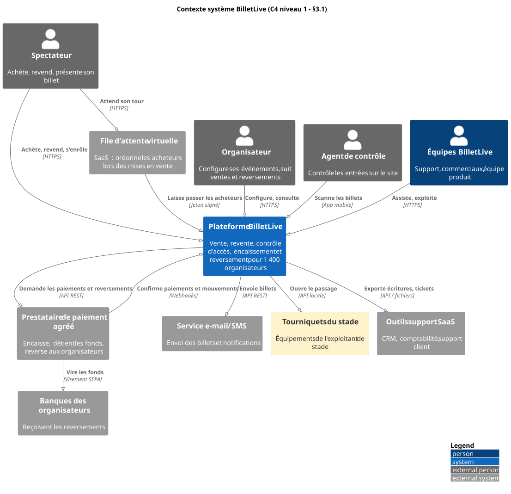
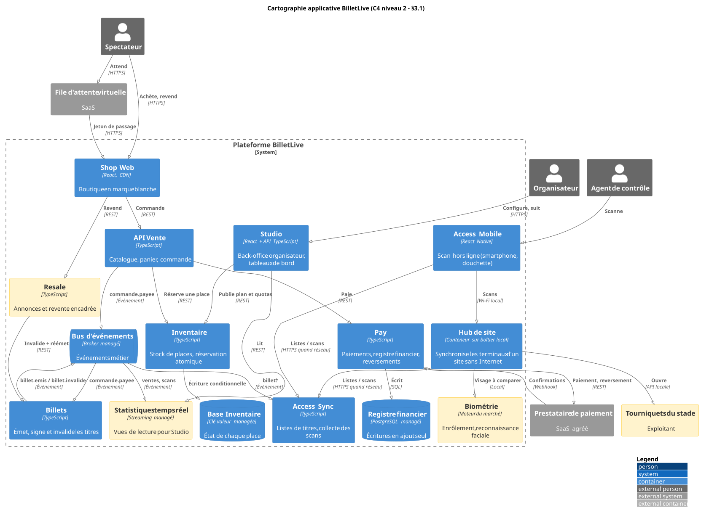
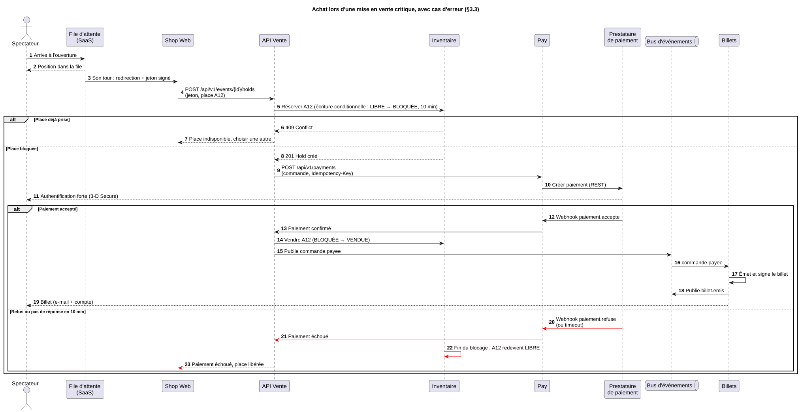

# 3. Vue applicative

## 3.1 Cartographie applicative

### Niveau 1 : contexte système

_Source : [03-contexte-systeme.puml](diagrammes/03-contexte-systeme.puml)_

La plateforme BilletLive est entourée de trois catégories de systèmes externes :

- deux services SaaS sur le chemin de la vente : la file d'attente virtuelle et le prestataire de paiement ;
- les tourniquets des stades ;
- des outils du marché pour les fonctions support : CRM, comptabilité, envoi d'e-mails et de SMS.

### Niveau 2 : conteneurs

_Source : [03-conteneurs.puml](diagrammes/03-conteneurs.puml)_

**Répartition des fonctions métier :**

| Offre     | Applications                                                    | Fonctions métier                                                          | Statut                                         |
| :-------- | :-------------------------------------------------------------- | :------------------------------------------------------------------------ | :--------------------------------------------- |
| Shop      | File d'attente (SaaS), Shop Web, API Vente, Inventaire, Billets | File d'attente, Réservation, Commande, Émission du titre                  | Conservée, découpée en services                |
| Studio    | Studio, Statistiques temps réel                                 | Configuration, Quotas, Planification, Règles de revente, Suivi temps réel | Conservée. Les statistiques sont **nouvelles** |
| Resale    | Resale                                                          | Remise en vente, Revente & Réémission                                     | **Nouvelle**                                   |
| Pay       | Pay                                                             | Encaissement, Reversement & Rapprochement                                 | Conservée, enrichie d'un registre financier    |
| Access    | Access Mobile, Access Sync, Hub de site                         | Scan, Synchronisation & Réconciliation                                    | Conservée. Le hub de site est **nouveau**      |
| Biométrie | Biométrie                                                       | Enrôlement, Reconnaissance faciale                                        | **Nouvelle**, facultative (EF-4)               |

L'onboarding des organisateurs passe par le CRM (outil support) et Studio. Le KYC (vérification d'identité de l'organisateur) est fait par le prestataire de paiement.

## 3.2 Applications principales

| Application              | Fonctions métier couvertes                       | Usage et utilisateurs                              | Produit du marché / développement spécifique                                                | Technologies                                       |
| :----------------------- | :----------------------------------------------- | :------------------------------------------------- | :------------------------------------------------------------------------------------------ | :------------------------------------------------- |
| File d'attente virtuelle | File d'attente                                   | Spectateurs lors des mises en vente                | **Produit du marché (SaaS)**, voir [ADR-SOLUTION-01](decisions/solution/adr-solution-01.md) | SaaS (ex. Queue-it, Cloudflare Waiting Room)       |
| Shop Web                 | Vitrine, achat, revente                          | Spectateurs, aux couleurs de l'organisateur        | Spécifique                                                                                  | React, servi par un CDN                            |
| API Vente                | Commande & Paiement                              | Appelée par Shop Web                               | Spécifique                                                                                  | TypeScript, conteneurs ou fonctions managés        |
| Inventaire               | Réservation de place, unicité                    | Appelé par API Vente, Studio et Resale             | Spécifique                                                                                  | TypeScript, base clé-valeur managée                |
| Billets                  | Émission, signature, invalidation des titres     | Appelé par API Vente et Resale                     | Spécifique                                                                                  | TypeScript, signature cryptographique des QR codes |
| Resale                   | Remise en vente, revente                         | Spectateurs                                        | Spécifique                                                                                  | TypeScript                                         |
| Pay                      | Encaissement, reversement, rapprochement         | Organisateurs (états), support                     | Spécifique, autour du prestataire de paiement                                               | TypeScript, PostgreSQL managé                      |
| Studio                   | Configuration, quotas, règles, tableaux de bord  | Organisateurs, support                             | Spécifique                                                                                  | React + API TypeScript                             |
| Statistiques temps réel  | Suivi temps réel                                 | Studio                                             | Service managé de streaming + code spécifique                                               | Streaming managé                                   |
| Access Mobile            | Scan                                             | Agents de contrôle (smartphone, douchette Android) | Spécifique                                                                                  | React Native, fonctionne hors ligne                |
| Access Sync              | Synchronisation & Réconciliation                 | Access Mobile, Hub de site                         | Spécifique                                                                                  | TypeScript                                         |
| Hub de site              | Synchronisation locale, pilotage des tourniquets | Grands sites et stades                             | Spécifique                                                                                  | Conteneur sur boîtier fourni prêt à l'emploi       |
| Biométrie                | Enrôlement, reconnaissance faciale               | Spectateurs volontaires, tourniquets               | **Produit du marché** (moteur de reconnaissance)                                            | Exécuté sur le Hub de site                         |

## 3.3 Flux applicatifs

| Flux                     | Source => cible                    | Nature               | Protocole / format                                                                      | Volume ou fréquence                                  |
| :----------------------- | :--------------------------------- | :------------------- | :-------------------------------------------------------------------------------------- | :--------------------------------------------------- |
| Entrée dans la file      | Spectateur => File d'attente       | Synchrone            | HTTPS                                                                                   | 180 000 personnes en 3 min                           |
| Passage vers la boutique | File d'attente => Shop Web         | Synchrone            | HTTPS + jeton signé                                                                     | Débit réglé selon la capacité de l'Inventaire        |
| Commande                 | Shop Web => API Vente              | Synchrone            | REST/JSON                                                                               | Jusqu'à 40 000 req/s en pointe, 200 req/s en nominal |
| Réservation de place     | API Vente => Inventaire            | Synchrone            | REST/JSON                                                                               | 1 par place achetée                                  |
| Paiement                 | Pay => Prestataire de paiement     | Synchrone            | REST/JSON                                                                               | ≈ 17 000 billets/jour en moyenne, × 3 à 2 ans        |
| Confirmation de paiement | Prestataire => Pay                 | Asynchrone           | Webhook HTTPS signé                                                                     | 1 par paiement                                       |
| Événements métier        | Services => Bus d'événements       | Asynchrone           | Messages JSON (topics `commande.payee`, `billet.emis`, `billet.invalide`, `acces.scan`) | Pic ≈ 1 000 msg/s                                    |
| Envoi du billet          | Billets => Service e-mail/SMS      | Asynchrone           | REST                                                                                    | 1 par billet                                         |
| Revente                  | Resale => Billets                  | Synchrone            | REST/JSON                                                                               | Faible (quelques % des billets)                      |
| Listes de titres         | Access Sync => Access Mobile / Hub | Batch + mises à jour | HTTPS/JSON                                                                              | Avant l'événement, puis à chaque connexion           |
| Scans                    | Access Mobile => Hub de site       | Synchrone local      | Wi-Fi local, sans Internet                                                              | Jusqu'à 60 000 en 1 h (stade)                        |
| Remontée des scans       | Hub / Access Mobile => Access Sync | Asynchrone           | HTTPS/JSON                                                                              | Dès que le réseau est disponible                     |
| Ouverture tourniquet     | Hub de site => Tourniquets         | Synchrone            | API locale de l'exploitant                                                              | ≈ 1 passage / 2,4 s / tourniquet                     |
| Rapprochement            | Prestataire => Pay                 | Batch                | Fichier de règlement (API ou SFTP)                                                      | Quotidien                                            |
| Écritures comptables     | Pay => Outil comptable             | Batch                | Fichier CSV                                                                             | Quotidien                                            |

### Flux détaillé : achat lors d'une mise en vente critique

_Source : [03-sequence-achat.puml](diagrammes/03-sequence-achat.puml)_

Ce flux concentre deux exigences critiques : EF-1 (unicité) et ENF-1 (pic de charge). Deux cas d'erreur y figurent :

- **place déjà prise** : l'écriture conditionnelle échoue (409) et l'acheteur choisit une autre place ;
- **paiement refusé ou sans réponse en 10 min** : le blocage expire et la place revient au stock.

La clé d'idempotence évite un double débit si l'acheteur clique deux fois.

## 3.4 Données et systèmes de référence

| Objet métier                              | Système de référence                             | Applications consommatrices             | Mode de propagation                            |
| :---------------------------------------- | :----------------------------------------------- | :-------------------------------------- | :--------------------------------------------- |
| Organisateur (contrat, commission)        | CRM                                              | Studio, Pay                             | API                                            |
| Coordonnées bancaires, KYC                | Prestataire de paiement                          | Pay                                     | API                                            |
| Événement, plan de salle, tarifs, quotas  | Studio                                           | Inventaire, Shop Web, Resale            | API + événement                                |
| État d'une place (libre, bloquée, vendue) | **Inventaire**                                   | API Vente, Resale, Statistiques         | API (lecture) + événement                      |
| Commande                                  | API Vente                                        | Pay, Statistiques                       | Événement                                      |
| Titre d'accès (billet)                    | **Billets**                                      | Access Sync, Access Mobile, Hub, Resale | Événement + listes téléchargées                |
| Annonce de revente                        | Resale                                           | Shop Web, Billets                       | API                                            |
| Paiement, mouvement financier             | Prestataire de paiement (fonds) / Pay (registre) | Studio, Outil comptable                 | Webhook + batch                                |
| Reversement                               | Pay                                              | Studio                                  | API                                            |
| Scan / entrée                             | Access Sync (Hub de site pendant l'événement)    | Statistiques, Studio                    | Événement                                      |
| Consentement et gabarit facial            | Biométrie                                        | Hub de site                             | Copie locale, effacée après l'événement (EF-7) |
| Compte spectateur                         | Fournisseur d'identité (voir chapitre 5)         | Shop Web, Resale                        | Jeton                                          |

**Données dupliquées et risques :**

- **Listes de titres sur les terminaux.** Les terminaux hors ligne peuvent ignorer une revente récente. Mesures :
  - chaque billet porte un numéro de version signé, et seule la dernière version est acceptée ;
  - la revente ferme 2 h avant l'ouverture des portes (choix de conception) ;
  - le Hub de site partage les scans entre portes, ce qui empêche la double entrée (EF-2).
- **Statistiques.** Ce sont des copies avec quelques secondes de retard. Studio affiche l'heure de la dernière mise à jour.
- **Paiement.** Le prestataire fait foi pour les fonds, Pay fait foi pour le détail par organisateur. Un rapprochement quotidien détecte les écarts (EF-5).

Aucun MDM : chaque objet a un seul système de référence.

## 3.5 Choix d'architecture applicative

**Type d'architecture.** Les applications sont découpées en services par domaine (un service par offre ou presque, pas des microservices fins). Elles sont déployées sur des services managés (conteneurs ou fonctions). Avec 12 développeurs, ce découpage permet de faire grossir seuls les services sollicités au moment des pics (Inventaire, API Vente) sans multiplier les composants à exploiter (ENF-3).

**Mode d'intégration.** Les services s'appellent en REST quand une réponse immédiate est nécessaire (réservation, paiement) et publient des événements sur un bus managé pour le reste (billets, statistiques, Access). Voir [ADR-SOLUTION-02](decisions/solution/adr-solution-02.md).

**Patterns utilisés :**

| Pattern                                                          | Où                      | Exigence servie                           |
| :--------------------------------------------------------------- | :---------------------- | :---------------------------------------- |
| File d'attente virtuelle                                         | Avant Shop Web          | ENF-1, EF-1 (équité)                      |
| CDN + cache du catalogue                                         | Shop Web                | ENF-1, ENF-4                              |
| Écriture conditionnelle + blocage temporaire                     | Inventaire              | EF-1, EF-6                                |
| Clé d'idempotence                                                | API Vente => Pay        | EF-5 (pas de double débit)                |
| Timeout + circuit breaker                                        | Pay => Prestataire      | Résilience en cas de panne du prestataire |
| Outbox (événement publié dans la même transaction que la donnée) | API Vente, Billets      | Aucun événement perdu                     |
| CQRS (vues de lecture séparées)                                  | Statistiques temps réel | EF-3 sans ralentir la vente               |
| Hors ligne d'abord + QR code signé                               | Access Mobile, Hub      | EF-2, ENF-2 (< 300 ms)                    |
| Registre en ajout seul                                           | Pay                     | EF-5 (traçabilité)                        |
| Étiquetage par organisateur et par événement                     | Tous                    | ENF-4 (coût mesurable)                    |

## 3.6 Impact de l'évolution sur les applications et les flux

| Évolution              | Applications                                                     | Flux et données                                       |
| :--------------------- | :--------------------------------------------------------------- | :---------------------------------------------------- |
| Resale                 | Nouvelle application Resale. Billets sait invalider et réémettre | Topic `billet.invalide` propagé jusqu'aux terminaux   |
| Suivi temps réel       | Nouvelle application Statistiques                                | Ventes et scans diffusés en continu vers Studio       |
| Reversement détaillé   | Registre financier dans Pay                                      | Rapprochement quotidien, état par transaction         |
| Grands stades          | Nouveau Hub de site, intégration des tourniquets                 | 60 000 scans en 1 h, traités localement               |
| Reconnaissance faciale | Nouvelle application Biométrie (produit du marché)               | Gabarits copiés sur le Hub, effacés après l'événement |
| International (× 3)    | Shop Web multilingue, Pay avec moyens de paiement locaux         | Volumes × 3, aucun nouveau flux                       |
